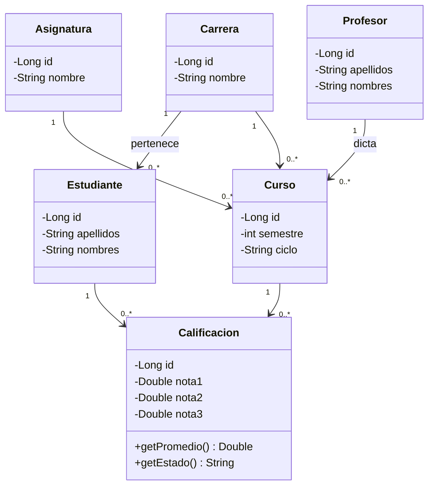

# UML de clases

Cada clase es una tabla (`carrera`, `asignatura`, `profesor`, `estudiante`, `curso`, `calificacion`) y las flechas son llaves foráneas.
Si tu UML tiene otras clases o atributos (cédula, correo, código de asignatura, etc.), pásamelo y lo ajusto.
